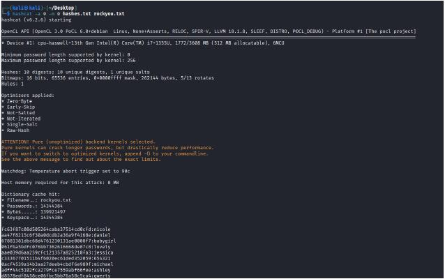
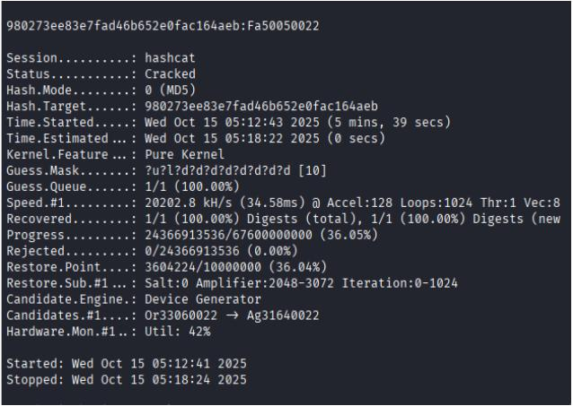
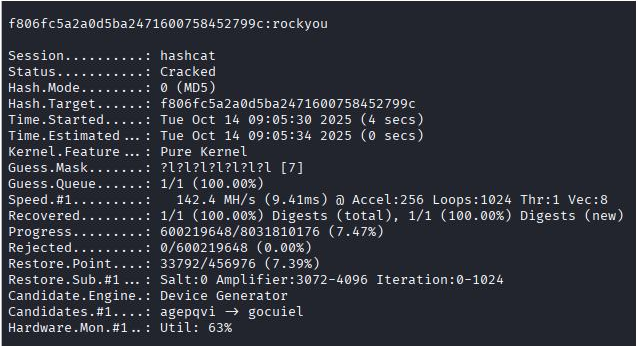

# Hashcat Password Security Analysis

**Author:** Khaled Abdulwakeel Al-Salami  
**Project type:** University practical security study  
**Main tool:** Hashcat  
**Lab environment described in the report:** Kali Linux in Oracle VirtualBox

## Project overview

This project explores offline password-hash auditing with Hashcat. It introduces the tool, compares Hashcat with John the Ripper and Hydra, documents a Kali Linux virtual-machine setup, and explains three password-auditing approaches: dictionary (straight), brute-force, and mask attacks.

The practical report focuses on MD5 test hashes and includes terminal evidence from dictionary and mask experiments. The original report is included in `report/` and the terminal screenshots have been extracted from its results pages.

## Objectives

- Understand the role of password hashing and offline hash auditing.
- Install and verify Hashcat in a Kali Linux lab.
- Explore dictionary, brute-force, and mask attack modes.
- Review how password patterns and wordlists affect audit results.
- Document the outcomes and practical challenges observed during the experiments.

## Tools and technologies

- Hashcat
- Kali Linux
- Oracle VirtualBox
- MD5 test hashes (Hashcat mode `0`)
- `rockyou.txt` wordlist, as referenced in the report

## Attack methods covered

| Method | Hashcat mode | Description |
|---|---:|---|
| Dictionary / straight | `-a 0` | Tests candidate passwords from a wordlist. |
| Brute-force / mask | `-a 3` | Generates candidates matching a specified character pattern. |

A mask is a constrained brute-force search. It can reduce the search space when the tested password format is already known, but an incorrect assumption about the format can cause the test to miss the password.

## Reported results

These are the results stated in the submitted project report, not new benchmark measurements:

- **Dictionary attack:** the report states that 9 hashes were recovered using `rockyou.txt` in approximately one second.
- **Mask attack:** the report records recovery of `Ff50050022` in approximately 5 minutes and 39 seconds. The displayed terminal output shows an MD5 hash and a mask consistent with one uppercase letter, one lowercase letter, and eight digits.
- A second mask-attack terminal result is also included in the report.

Actual performance depends on the hash algorithm, hardware, candidate space, Hashcat configuration, and test data.

## Command reference

The commands in [`COMMANDS.md`](COMMANDS.md) explain installation checks, dictionary mode, mask mode, brute-force examples, and viewing recovered results. Run them only against hashes you own or are explicitly authorized to audit.

## Screenshots

### Dictionary attack


## Screenshots

### Dictionary Attack


### Mask Attack - First Result


### Mask Attack - Second Result


All screenshots are original evidence from the practical experiments.


All three images above are crops of the original terminal screenshots embedded in pages 7–8 of the project report; they have not been recreated.

## Repository structure

```text
Hashcat-Password-Security-Analysis/
├── README.md
├── COMMANDS.md
├── report/
│   └── Hashcat-Project-Report-Khaled.pdf
└── screenshots/
    ├── dictionary-attack.png
    ├── mask-attack-1.png
    └── mask-attack-2.png
```

## Limitations

- The experiments documented in the report use MD5 test hashes; the results should not be generalized to modern password-hashing schemes such as bcrypt, scrypt, or Argon2.
- The timings are specific to the environment and test data described in the report.
- This repository documents a lab study; it is not a standalone password-cracking application.

## Ethical use

Hashcat is a dual-use security tool. Use it only for password recovery or authorized security assessments. Do not test hashes, accounts, or systems without permission.

## References

- [Hashcat official website](https://hashcat.net/hashcat/)
- [Hashcat wiki](https://hashcat.net/wiki/)
- [Kali Linux Hashcat package](https://www.kali.org/tools/hashcat/)
- [Kali Linux wordlists package](https://gitlab.com/kalilinux/packages/wordlists)
